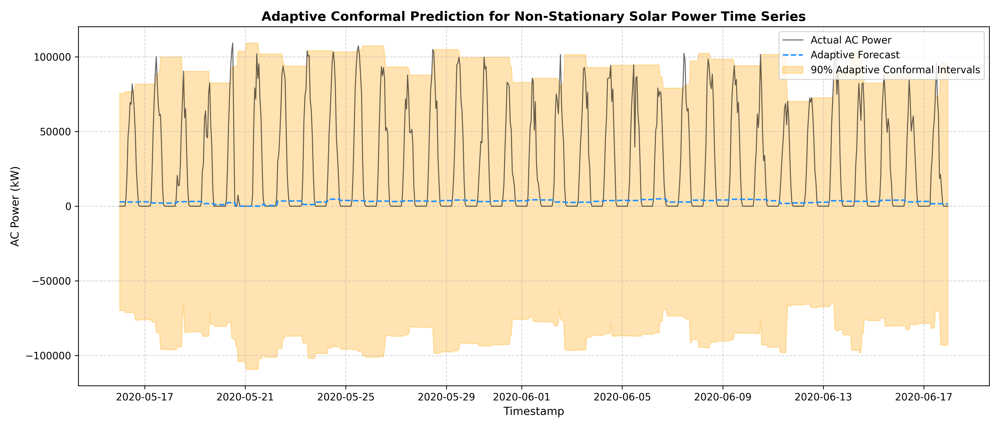

# Adaptive Conformal Prediction for Time Series

## Overview
This repository implements an Adaptive Conformal Inference (ACI) framework for uncertainty quantification in non-stationary time-series forecasting, applied to real-world solar photovoltaic generation data.

## Key Features
- **Uncertainty Quantification:** Generates rigorous prediction intervals with guaranteed coverage under distribution shifts.
- **Adaptive Control:** Dynamically adjusts miscoverage rates online to handle atmospheric volatility and non-stationarity.
- **Diagnostic Visualization:** Plots time-series forecasts alongside adaptive conformal bounds.

## Visual Results

## Tech Stack
- **Language:** Python
- **Libraries:** NumPy, Pandas, Matplotlib
- **Environment:** Google Colab
